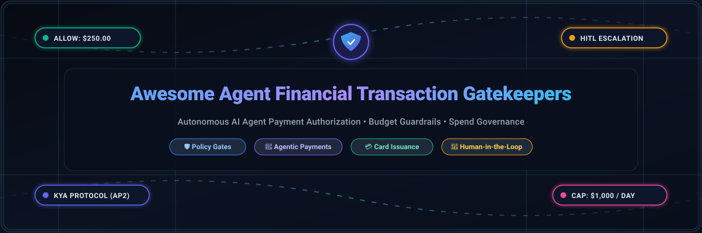

<p align="center">
  
</p>

<p align="center">
  <a href="https://github.com/ishandutta2007/Awesome-Awesome-Awesome"></a><a href="https://discord.gg/jc4xtF58Ve"></a>
  <a href="https://github.com/ishandutta2007/Awesome-Agent-Financial-Transaction-Gatekeepers/stargazers"></a>
  <a href="https://github.com/ishandutta2007/Awesome-Agent-Financial-Transaction-Gatekeepers/network/members"></a>
  <a href="https://github.com/ishandutta2007/Awesome-Agent-Financial-Transaction-Gatekeepers/issues"></a>
  <a href="https://github.com/ishandutta2007/Awesome-Agent-Financial-Transaction-Gatekeepers/blob/main/LICENSE"></a>
  <a href="https://github.com/ishandutta2007"></a>
</p>

---

# 🛡️ Awesome Agent Financial Transaction Gatekeepers

> **A curated, battle-tested directory of SaaS platforms, open-source policy engines, and deterministic guardrail frameworks for autonomous AI agent payment authorization, spending limits, human-in-the-loop (HITL) approval, and financial spend governance.**

---

## 🔍 Overview & Architecture

Autonomous AI agents (LLM agents, Model Context Protocol/MCP tools, AutoGPT, LangGraph, Bedrock, and Claude Code) are increasingly empowered to procure services, execute trades, settle invoices, and move real funds. However, LLM reasoning is probabilistic and non-deterministic—leaving systems vulnerable to prompt injections, hallucinated invoices, and runaway spend loops.

**Agent Financial Transaction Gatekeepers** serve as the mission-critical, fail-closed policy middleware between autonomous AI decision loops and raw financial execution rails (card networks, ACH/SEPA, stablecoins, and lightning payments).

```
                      ┌────────────────────────────────────────┐
                      │        🤖 Autonomous AI Agent          │
                      │  (MCP / LangGraph / Bedrock / Claude)  │
                      └──────────────────┬─────────────────────┘
                                         │ 1. Transaction Request
                                         ▼
                      ┌────────────────────────────────────────┐
                      │   🛡️ AGENT TRANSACTION GATEKEEPER    │
                      │   • KYA Identity (Signed Mandates)     │
                      │   • Hard Budget Caps & Velocity Limits │
                      │   • Merchant Allowlists & MCC Filters  │
                      │   • Cryptographic Policy Engine        │
                      └──────┬──────────────────────┬──────────┘
                             │                      │
                  [Within Policy Limit]     [Above Risk Threshold]
                             │                      │
                             ▼                      ▼
                      ┌─────────────┐       ┌──────────────────┐
                      │  ✅ ALLOW   │       │ 👤 HITL Escalate │
                      │  Execute    │       │ (Human Approval) │
                      └──────┬──────┘       └─────────┬────────┘
                             │                        │
                             ▼                        ▼
                      ┌────────────────────────────────────────┐
                      │    💳 Financial Execution & Rails      │
                      │ (Stripe, Visa Virtual Cards, USDC/x402)│
                      └──────────────────┬─────────────────────┘
                                         │
                                         ▼
                      ┌────────────────────────────────────────┐
                      │ 📜 Tamper-Evident Hash Audit Ledger   │
                      └────────────────────────────────────────┘
```

---

## 📑 Table of Contents

- [🛡️ Awesome Agent Financial Transaction Gatekeepers](#️-awesome-agent-financial-transaction-gatekeepers)
  - [🔍 Overview \& Architecture](#-overview--architecture)
  - [📑 Table of Contents](#-table-of-contents)
  - [🌐 Sector Overview \& Market Dynamics](#-sector-overview--market-dynamics)
  - [🏢 SaaS \& Hosted Gatekeeper Platforms](#-saas--hosted-gatekeeper-platforms)
  - [🔓 Open-Source Gatekeepers \& Policy Frameworks](#-open-source-gatekeepers--policy-frameworks)
  - [🧩 Key Protocols \& Standards for Agentic Payments](#-key-protocols--standards-for-agentic-payments)
  - [🤝 How to Contribute](#-how-to-contribute)
  - [💖 Support \& Sponsoring](#-support--sponsoring)
  - [📈 Star History](#-star-history)
  - [⚖️ Disclaimer \& Compliance Notice](#️-disclaimer--compliance-notice)

---

## 🌐 Sector Overview & Market Dynamics

The **AI Agent Financial Gatekeeper & Agentic Commerce** infrastructure sector represents an estimated addressable market expanding from **$1.8B in 2025 to over $28.5B by 2032 (CAGR ~48.2%)**, propelled by the rapid transition from human-supervised checkout to autonomous machine-to-machine (M2M) procurement, SaaS API consumption, and automated treasury management.

### Market Structure & Concentration:
* **Moderately Fragmented Dual-Layer Dynamics**: The market features a bifurcated competitive structure.
  * **Settlement & Issuing Rails (Concentrated / Winner-Take-Most)**: Traditional card networks and payment titans (Stripe Issuing, Visa, MoonPay) retain significant dominance due to regulatory moats, banking licenses, and global merchant acceptance networks.
  * **Policy Enforcement & Gatekeeping Middleware (Highly Fragmented & Innovating)**: The upper orchestration layer—responsible for KYA (Know Your Agent) identity verification, deterministic budget fences, mandate generation (AP2, x402, MPP), and human-in-the-loop workflows—remains dynamically fragmented among specialized startups, protocol consortiums, and open-source self-hostable policy kernels.

---

## 🏢 SaaS & Hosted Gatekeeper Platforms

Below is a curated comparison of hosted enterprise platforms and managed services providing policy enforcement, virtual card issuance, and payment guardrails for autonomous agents.

> **Sorted by Company Size / Valuation / Capital (Descending):**

| 🏢 Platform / Provider | 🎯 Core Gatekeeping & Authorization Features | 💰 Company Size (Valuation / Revenue) | 🏷️ Starting Tier Pricing | 🎁 Free Tier Limits / Trial Allowances |
| :--- | :--- | :--- | :--- | :--- |
| **[Google Cloud / AP2](https://ap2-protocol.org/)** | Open Agent Payments Protocol specification backed by Google Cloud; signed mandates (Cart/Purchase/Payment) with cryptographic constraint validation; multi-rail settlement across cards, ACH, and stablecoins with 60+ financial institutions. | **~$2.2T Market Cap** *(Alphabet / Google Cloud)* | **Free protocol specification**; Cloud deployment starts at **$0.0000025 / Cloud Run request** or **$3.00 / 1M Cloud Endpoints calls** | **Free open specification & SDK forever**; Google Cloud Free Tier provides **2M Cloud Run requests/month** and **$300 credits for 90 days** |
| **[Stripe Agent Toolkit / Issuing](https://stripe.com/)** | Virtual and physical card issuance for AI agents with programmatic merchant category restrictions (`allowed_categories`), per-agent spend velocity rules, machine-to-machine payment tokens, and card-network decline enforcement prior to fund settlement. | **$70B Valuation** *(~$14B+ annual net revenue)* | **$0.10 per virtual card** created; **0.2% + $0.20 per card transaction** (applied after initial volume threshold) | **Free developer testmode sandbox forever**; **$0 transaction fees on first $500,000** in cumulative card spend volume |
| **[Rain Cards](https://raincards.com/)** | Visa Principal Member corporate card program designed for autonomous agent treasuries; on-chain stablecoin-backed spending limits, programmatic velocity rules, merchant whitelisting, and automated emergency kill-switches. | **$1.95B Valuation** *($250M Series C; $338M+ total funding)* | **0% purchase APR**; up to **3.0% on cross-border / non-USD FX**; custom API volume tiers for enterprise card programs | **Free sandbox API environment forever**; **$0 monthly platform maintenance fee** for qualifying corporate accounts |
| **[Helio (MoonPay Commerce)](https://helio.com/)** | Multi-chain checkout and agent payment gateway; programmable pay links, budget limits, webhooks, and human-in-the-loop review triggers before on-chain smart contract execution. | **$175M Acquisition** *(Acquired by MoonPay; $12M valuation at seed)* | **1.0% per transaction** for standard API checkout and Pay Links (reduced to **0.25% - 0.50%** via HelioX Pass or high volume) | **Free account setup forever with unlimited sandbox API testing**; **$0 monthly subscription fee** (pure pay-as-you-transact) |
| **[Crossmint](https://www.crossmint.com/)** | Smart agent wallets, virtual Visa cards, stablecoin orchestration, merchant allowlists, threshold-based human sign-off triggers, and automated compliance screening via TRM Labs. | **$23.6M Funding** *(Series A led by Ribbit Capital in 2025; 1,100% ARR growth)* | **$0.025 per active wallet/month** beyond free allowance + standard payment checkout processing fees | **Free forever tier with 1,000 Monthly Active Wallets (MAWs)**, gas sponsorship sandbox, and staging environment access |
| **[Payman AI](https://paymanai.com/)** | Core-banking integrated policy layer for credit unions and banks (FIS, Fiserv, Jack Henry); per-transaction/daily spend limits, configurable escalation thresholds requiring manual operator approval, and tamper-evident audit trails. | **$13.8M Funding** *(Series A backed by Visa, Coinbase Ventures, Circle, Boost VC)* | Developer API starts at **$0.05 + 1.5% per payment execution**; custom annual enterprise pilot tiers for regulated banking cores | **30-day developer pilot sandbox** with up to **100 simulated policy-gated transactions** and full compliance dashboard access |
| **[Skyfire Systems](https://skyfire.xyz/)** | KYA (Know Your Agent) identity and JWT payment tokens; per-agent spending caps, request-count ceilings, token expiry timestamps, and support for tokenized Visa/Mastercard cards and USDC on Base. | **$9.5M Funding** *(Seed + extension backed by Coinbase Ventures, a16z CSX, Ripple, Circle)* | **$0.005 per token verification** + **1.5% to 2.5% per transaction** execution fee on live network transfers | **Free developer sandbox access forever** with **$10 in complimentary test USDC tokens** and **500 free KYA verification calls** |
| **[Sphere Labs](https://sphere.xyz/)** | Stablecoin cross-border payout routing, programmable escrow settlement, and policy gatekeeper APIs enforcing basis-point fee rules and maximum disbursement thresholds. | **$7.8M Funding** *($5M round backed by Coinbase Ventures & Kraken Ventures)* | API payout rails starting at **25 basis points (0.25%) to 50 basis points (0.50%)** per settled transaction | **Free sandbox API keys forever** with **unlimited testnet transfer simulation** and **$0 monthly minimum platform fee** |
| **[Nevermined](https://nevermined.io/)** | Scoped delegation tokens and decentralized access budgets; treats agent budgets as revocable, server-enforced constraints with dynamic metering and credit management. | **$7.0M Funding** *($4M Jan 2025 round led by Generative Ventures; €3M prior seed)* | Premium plan starts at **$250/month** (up to 100 agents, 50 payment plans); merchant take rate of **1.0% (crypto/stablecoin)** or **2.0% (cards)** | **Free forever plan supporting up to 20 agents, 10 payment plans**, dynamic metering, payment widget access, and credit settlement |
| **[Openfort](https://www.openfort.io/)** | Policy Engine v2 for autonomous agent wallets; rail-agnostic pre-transaction policy evaluations, non-custodial smart contracts, session keys, and cryptographic audit trails. | **$3.0M Funding** *(Seed led by Gumi Cryptos Capital & Maven 11; Bain Capital Crypto)* | Growth plan starts at **$99/month** (including 10,000 operations); overages at **$0.01 per operation** | **Free forever tier with 2,000 operations/month**, smart account abstraction, Bring Your Own Auth (JWT), and 1 webhook |

---

## 🔓 Open-Source Gatekeepers & Policy Frameworks

Self-hosted, transparent, and vendor-independent policy engines, spending gateways, and deterministic audit loggers for platform engineers building agentic payment safety.

> **Sorted by GitHub Stars (Descending):**

| 📦 Repository & Name | ⭐ GitHub Stars | 🛡️ Gatekeeping Mechanism & Architecture | 💻 Tech Stack |
| :--- | :--- | :--- | :--- |
| **[agentgateway/agentgateway](https://github.com/agentgateway/agentgateway)** | [](https://github.com/agentgateway/agentgateway/stargazers) | Next-generation reverse proxy and tool execution control plane for AI agents and MCP servers. Implements granular tool authorization, rate limits, spending boundaries, and human-in-the-loop approvals. | Go, TypeScript, MCP |
| **[solana-foundation/pay](https://github.com/solana-foundation/pay)** | [](https://github.com/solana-foundation/pay/stargazers) | Official CLI and payment gateway for Agentic payments supporting x402, MPP, and AP2 protocols with machine-speed execution and deterministic policy checks. | TypeScript, Rust |
| **[coinbase/agentkit](https://github.com/coinbase/agentkit)** | [](https://github.com/coinbase/agentkit/stargazers) | Framework providing autonomous AI agents onchain wallets with programmable financial actions, spending caps, and cross-chain transfers on Base and EVM chains. | Python, TypeScript |
| **[usehelix/helix](https://github.com/usehelix/helix)** | [](https://github.com/usehelix/helix/stargazers) | Self-healing payment infrastructure for AI agents with 90.3% auto-recovery, failover policies, and budget-guardrailed autonomous transaction dispatching. | TypeScript, Node.js |
| **[omnuron/omniclaw](https://github.com/omnuron/omniclaw)** | [](https://github.com/omnuron/omniclaw/stargazers) | Agentic payment network featuring the OmniClaw Financial Policy Engine, enabling policy-controlled, gasless, and hard-budgeted machine transactions. | Rust, TypeScript |
| **[worldliberty/agentpay-sdk](https://github.com/worldliberty/agentpay-sdk)** | [](https://github.com/worldliberty/agentpay-sdk/stargazers) | Open SDK for agentic payments enabling AI agents to hold funds and move money across chains with built-in policy enforcement and human approval thresholds. | TypeScript, Solidity |
| **[MPP32/MPP32](https://github.com/MPP32/MPP32)** | [](https://github.com/MPP32/MPP32/stargazers) | Universal machine payments protocol layer for autonomous agent transactions, multi-currency routing, and deterministic settlement validation. | Go, TypeScript |
| **[ciceroyang/agentgate](https://github.com/ciceroyang/agentgate)** | [](https://github.com/ciceroyang/agentgate/stargazers) | Tool-layer control plane for AI agents managing tool inventory, execution evidence, authorization policies, and cryptographic approval verification. | Go, Python |
| **[Justin0504/Sovereign-OS](https://github.com/Justin0504/Sovereign-OS)** | [](https://github.com/Justin0504/Sovereign-OS/stargazers) | Constitution-first AI orchestration OS where a YAML Charter enforces fiscal discipline: CEO plans, CFO approves via balance checks and daily burn caps, and append-only UnifiedLedger tracks spend. | Python, Stripe, MCP |
| **[solana-foundation/pay-kit](https://github.com/solana-foundation/pay-kit)** | [](https://github.com/solana-foundation/pay-kit/stargazers) | Polyglot building blocks for agentic payments (x402, MPP) across TypeScript, Rust, Go, and Python over HTTP, MCP, and A2A interfaces. | TypeScript, Rust, Go, Python |
| **[agentkitai/agentgate](https://github.com/agentkitai/agentgate)** | [](https://github.com/agentkitai/agentgate/stargazers) | Dedicated human-in-the-loop approval workflows and spending guardrails designed for financial agent tool executions. | TypeScript |
| **[nevermined-io/payments](https://github.com/nevermined-io/payments)** | [](https://github.com/nevermined-io/payments/stargazers) | TypeScript SDK for the Nevermined protocol, enabling agent payment authorizations, metered balance debits, and scoped budget grants. | TypeScript |
| **[presidio-v/presidio-hardened-x402](https://github.com/presidio-v/presidio-hardened-x402)** | [](https://github.com/presidio-v/presidio-hardened-x402/stargazers) | Security middleware for x402 agentic payments with spending policy enforcement, PII redaction, and replay detection before blockchain commit. | Python, TypeScript |
| **[langoai/lango](https://github.com/langoai/lango)** | [](https://github.com/langoai/lango/stargazers) | Go-based agent payment framework with built-in governance, USDC payments on EVM chains, X402 auto-pay protocol, daily limits, and Security Sentinel engine. | Go, EVM, X402 |
| **[felixpg13-glitch/spendshield](https://github.com/felixpg13-glitch/spendshield)** | [](https://github.com/felixpg13-glitch/spendshield/stargazers) | Open-source payment safety layer for Python and MCP agents featuring KYA agent identity, 4 deterministic gates (budget, dry-run, max-amount, approval), and AES-256 secret vault. | Python, MCP, SQLite |
| **[neosun100/openAgentPay](https://github.com/neosun100/openAgentPay)** | [](https://github.com/neosun100/openAgentPay/stargazers) | Pluggable Agent Payments platform for AWS Bedrock AgentCore with 7-layer guardrail system, 22 protocol adapters (x402, AP2, ACP, MPP), and 61 wallet connectors. | Python, AWS Bedrock |
| **[insightitsGit/prismagenticpay](https://github.com/insightitsGit/prismagenticpay)** | [](https://github.com/insightitsGit/prismagenticpay/stargazers) | Deterministic payment authorization service with ES256 mandate verification, multi-bucket capacity reservation, and durable SQLite audit persistence. | Python, SQLite, ES256 |
| **[esploro-group/closegate](https://github.com/esploro-group/closegate)** | [](https://github.com/esploro-group/closegate/stargazers) | SOC 2-compliant policy gate for finance AI agents with append-only hash-chained audit logging, 4-tier risk classification, and server-side dual-HITL approval envelopes. | Python, SQLite, Docker |
| **[fangyunok/finscope-agent](https://github.com/fangyunok/finscope-agent)** | [](https://github.com/fangyunok/finscope-agent/stargazers) | Financial agent with 50-digit Decimal calculation precision, hard budget constraint filtering, and cryptographic 3-way memory verification. | Python, LangChain |
| **[envoy-pay/envoy-pay](https://github.com/envoy-pay/envoy-pay)** | [](https://github.com/envoy-pay/envoy-pay/stargazers) | On-chain payment authorization engine with EIP-712 signed authorizations, ERC-8004 agent wallets, and rolling-window spending limit enforcement on Celo. | Solidity, Celo |

---

## 🧩 Key Protocols & Standards for Agentic Payments

Understanding the core protocols governing autonomous agent finance:

* **AP2 (Agent Payments Protocol)**: Google Cloud standard utilizing cryptographic Cart and Payment Mandates to represent intent, price, and execution authorization.
* **x402 (HTTP 402 Payment Required)**: Standard HTTP status code revived for machine-to-machine micro-payments, charging agents per HTTP request or tool invocation via Lightning, Solana, or Base.
* **MPP (Machine Payments Protocol)**: Standardized messaging framework for cross-chain and fiat agentic commerce.
* **KYA (Know Your Agent)**: Cryptographic identity attestation ensuring counterparty services can verify the principal, owner, and spending bounds of an autonomous agent before accepting transactions.

---

## 🤝 How to Contribute

Contributions from platform engineers, compliance teams, and open-source fintech builders are warmly encouraged!

1. 🍴 **Fork the repository**.
2. 🌿 **Create a new branch** (`git checkout -b feature/add-gatekeeper-tool`).
3. 📝 **Add or update entries** following the tabular format:
   - For SaaS tools: include verified starting tier pricing, free tier limits/trial details, and company valuation/revenue metrics.
   - For Open-Source projects: provide GitHub link with social star badge, architectural mechanism summary, and stack details.
4. ✅ **Ensure accuracy**: Verify that pricing and free trial terms are explicit and supported by official documentation.
5. 🚀 **Submit a Pull Request** with a concise description of your additions.

---

## 💖 Support & Sponsoring

Thank you for visiting and supporting the **Awesome Agent Financial Transaction Gatekeepers** ecosystem! 🌟

If you find this curated resource helpful for your research, team, or project:
- ⭐ **Star this repository** to help others discover it.
- 🍴 **Fork it** to contribute new platforms, policy engines, and gatekeeper tools.
- 📢 **Share it** on social platforms, Twitter/X, LinkedIn, Discord, and Slack communities.
- ☕ **Buy me a coffee / Sponsor**: If you'd like to support ongoing curation and open-source fintech research, please consider sponsoring via the [GitHub Sponsors Dashboard](https://github.com/sponsors/ishandutta2007). Every contribution is deeply appreciated!

---

## 📈 Star History

[](https://star-history.dera.page/#ishandutta2007/Awesome-Agent-Financial-Transaction-Gatekeepers&type=date&legend=top-left)

---

## ⚖️ Disclaimer & Compliance Notice

- 📋 This is a **community-curated research directory**—not an endorsement, investment advice, or legal opinion.
- 💳 AI agent gatekeepers processing real-world currency must comply with applicable banking and payment regulations (PCI-DSS Level 1, PSD2 Strong Customer Authentication, SOC 2 Type II, AML/KYC, and FATF Travel Rule requirements).
- 🔒 **Deterministic Defense Rule**: A spending limit should be enforced automatically in code, not via LLM system prompts. Prompt instructions can be bypassed via prompt injections. Always enforce hard stops at the network, API gateway, or card-issuing layer.
- 🧪 **Verification Rule**: Send a transaction that exceeds your configured limit and confirm that it is **actively blocked and declined, not merely logged**.
